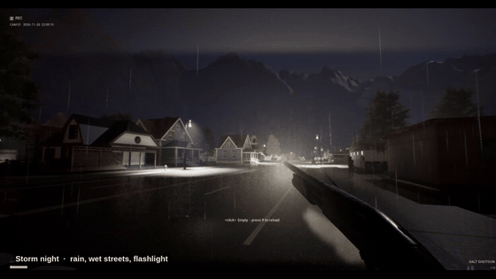
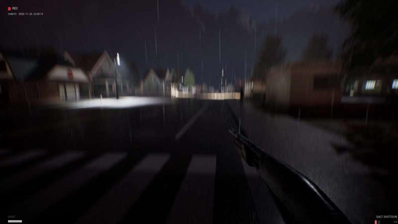
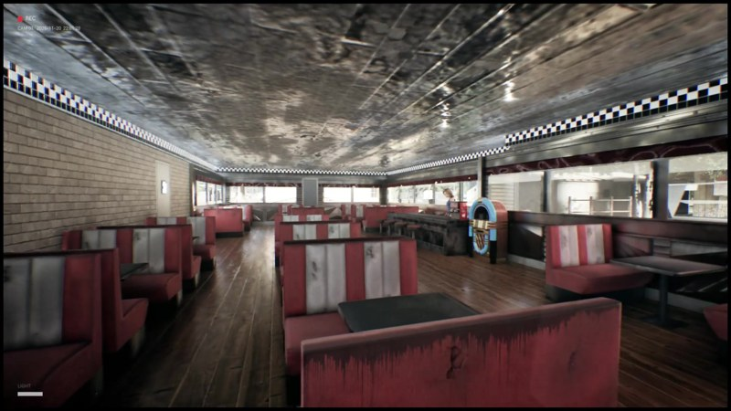
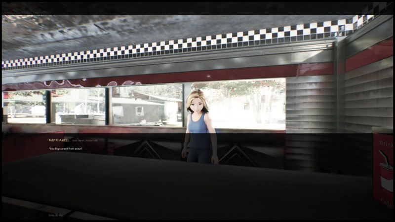
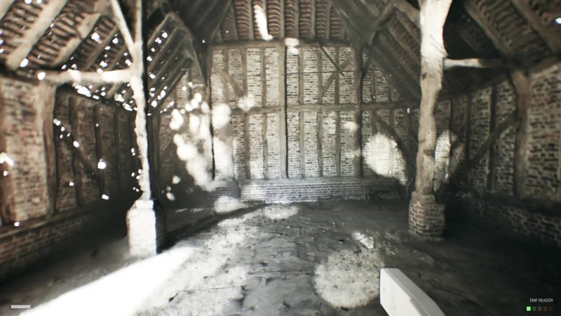
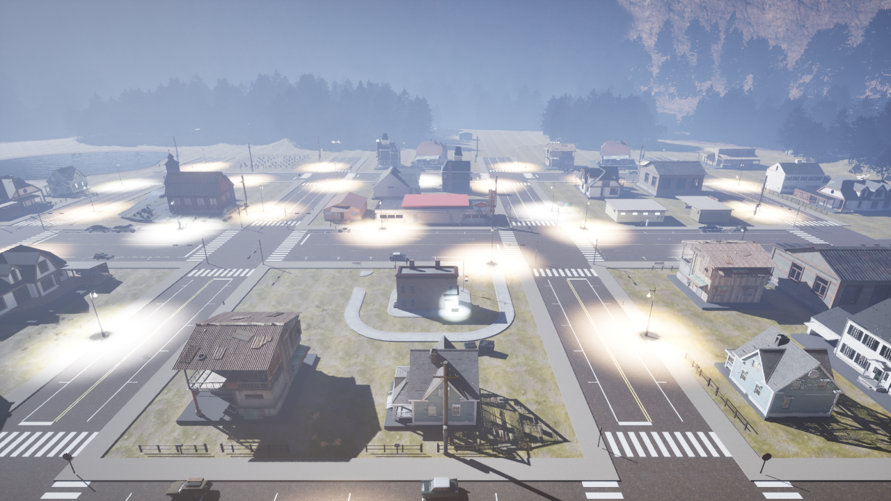
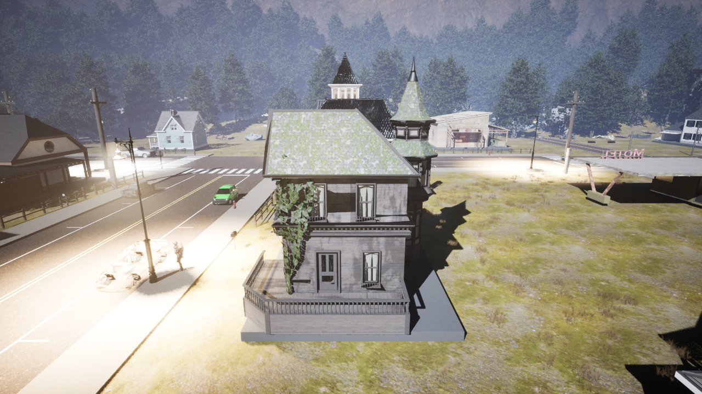
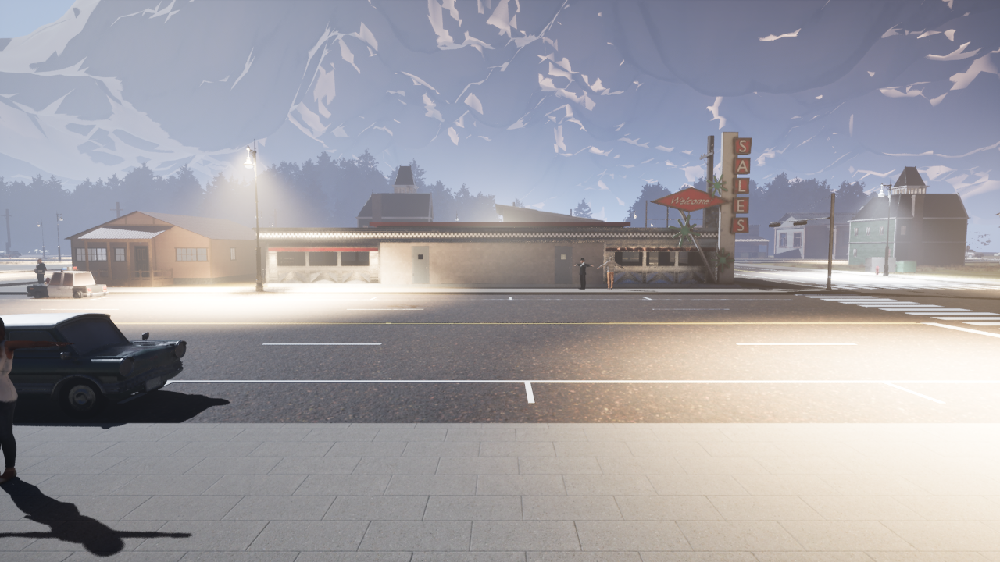
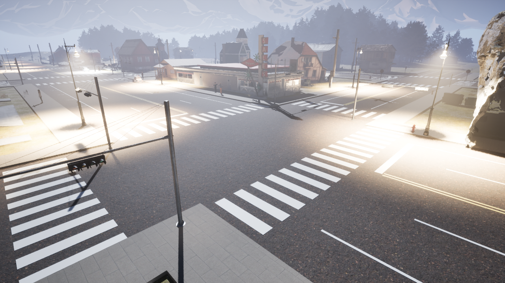
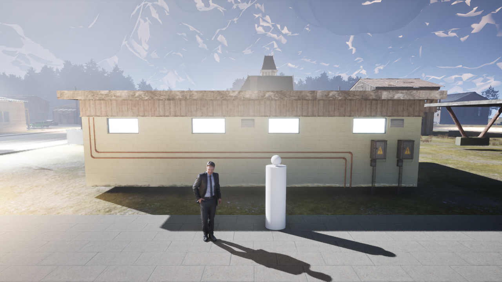

# Fallen Brothers

<a href="Media/FallenBrothers_gameplay_720p.mp4"><b>Watch the 90-second gameplay video (MP4)</b></a> · <a href="Media/FallenBrothers_teaser.mp4">Teaser</a>

A first-person supernatural investigation game built solo in **Unreal Engine 5.7** with **C++** (~150 source files, gameplay written almost entirely in C++).

Two brothers travel from town to town solving supernatural cases. Each case combines a daytime investigation (questioning townspeople, researching the town's history, tracking EMF readings at the victims' last-seen spots) with a night-time confrontation, all presented through a realistic bodycam-style camera.

> This repository is a **code showcase**: it contains the C++ source and config. Art and audio assets are not included because many of them are third-party assets that cannot be redistributed (see `FB_Credits.txt`).

## Gameplay captures

| | |
|---|---|
|  |  |
|  |  |

## Early screenshots

Work-in-progress captures of the procedurally generated town.

| | |
|---|---|
|  |  |
|  |  |
|  | |

## Systems

| Area | What's implemented | Code |
|---|---|---|
| **Player** | First-person character, bodycam camera (lens, sway, head-bob, recording overlay) | `Player/` |
| **Investigation** | Case files, case journal, in-game research computer, evidence items | `Investigation/`, `Interaction/` |
| **Equipment** | Flashlight, EMF detector, UV light, salt canister, shotgun, silver knife; equipment component + inventory | `Equipment/`, `Inventory/` |
| **Paranormal** | Ghosts, poltergeist, UV traces, salt lines, paranormal hotspots, grave sites and bound relics | `Paranormal/` |
| **AI** | AI brother companion, creatures, townspeople and pedestrians with dialogue | `Companion/`, `Creatures/`, `Town/`, `Dialogue/` |
| **Missions** | Case director (day investigation -> night confrontation), mission manager, campaign subsystem | `Mission/` |
| **Physics** | Grab / swing / throw objects, breakables, environmental traps (e.g. dropping a chandelier on a ghost) | `Physics/` |
| **World** | Procedural town map generator, street network, buildings, props, street lamps, weather, snow, terrain, mountains, atmosphere | `Town/`, `Environment/` |
| **Meta** | Save system, main / pause menus, settings, HUD | `Save/`, `UI/`, `Core/` |

## Status

Work in progress. Current goal: a polished, roughly **one-hour playable demo chapter**. The full design has 13 missions, each with its own story.

## Tech

- Unreal Engine 5.7, C++ (minimal Blueprints)
- Visual Studio

## Author

**Zeki Yiğit Uçar** - Computer Engineering student, Adana Alparslan Türkeş Science and Technology University
